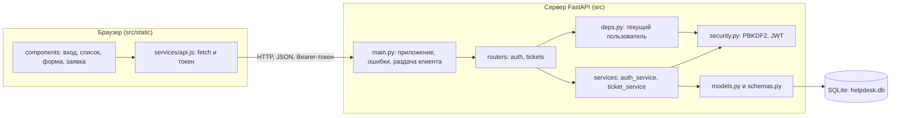
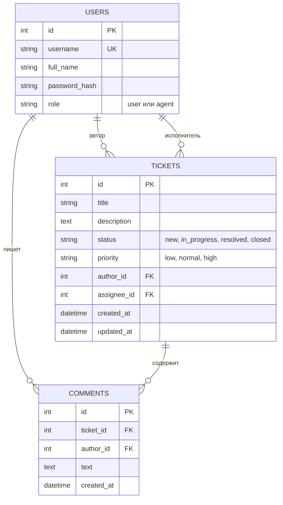

# Архитектура

## Компоненты

## Слои сервера

| Слой | Файлы | Ответственность |
|------|-------|-----------------|
| Маршруты | `routers/` | Принимают запрос, проверяют формат данных через схемы, вызывают сервисы |
| Сервисы | `services/` | Правила предметной области: кто что видит и меняет, допустимые переходы статусов |
| Данные | `models.py`, `database.py` | Таблицы и подключение к БД |
| Безопасность | `security.py`, `deps.py` | Хэширование паролей, выпуск и проверка токенов, определение текущего пользователя |
| Ошибки | `utils/errors.py`, `main.py` | Единый формат ошибок `{"detail": "..."}` на русском языке |

## Модель данных

## Сценарий запроса

1. Клиент отправляет `POST /api/auth/login`, сервер проверяет пароль и возвращает JWT.
2. Токен сохраняется в браузере и добавляется в заголовок каждого следующего запроса.
3. `deps.get_current_user` расшифровывает токен и загружает пользователя; без валидного токена возвращается 401.
4. Сервис проверяет права (роль, авторство) и выполняет действие; при нарушении возвращает 403, 404 или 409.

## Права доступа

| Действие | Сотрудник | Поддержка |
|----------|-----------|-----------|
| Видеть заявки | только свои | все |
| Создать заявку | да | да |
| Комментировать | в своих заявках | в любых |
| Менять статус | закрыть свою или открыть заново | любой |
| Менять приоритет и исполнителя | нет | да |

## Клиент

Одностраничное приложение без сборки. Маршрутизация по `location.hash` (`#/`, `#/new`, `#/ticket/<id>`). Все элементы создаются через `utils/dom.js` без `innerHTML`, поэтому пользовательский текст не может внедрить разметку. На узком экране показывается одна панель (список или заявка), на широком обе.
